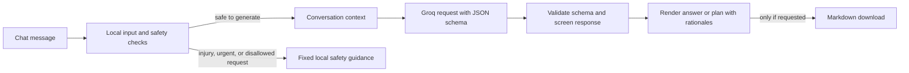

# CoachBot AI

<p align="center">
  
</p>

<p align="center">
  <a href="https://streamlit.io/"></a>
  <a href="https://groq.com/"></a>
  
  
</p>

> CoachBot is a youth-sports prototype for asking sports and general-wellness questions, continuing a conversation, and requesting general practice plans. English is the default. Each plan suggestion carries a short rationale.

**Important:** CoachBot is not a doctor, physiotherapist, or qualified coach. It does not diagnose, prescribe treatment, or clear a player to return to sport. Personal injury and urgent-symptom requests are routed to fixed local guidance instead of being sent to Groq. Ask a qualified adult or professional for personal health and recovery decisions.

## Project at a glance

| Item | Details |
|---|---|
| App | [CoachBot AI](app.py) |
| Interface | Streamlit chat, conversation history, profile/settings, day/night appearance |
| Model service | Groq Chat Completions through `requests` |
| Default model | `openai/gpt-oss-20b` in `config.py`; availability must be checked for your key |
| Structured output | Pydantic contracts in `core/schemas.py`; JSON schema is sent to Groq |
| Optional account login | Streamlit OpenID Connect; Google can provide identity |
| Optional cross-session memory | Supabase REST storage, configured by the app owner |
| English | Default response language; another language must be selected |
| Assessment content | Student-owned research, prompt variants, testing findings, and personal reflections remain marked `[MY INPUT NEEDED]` where they must be completed by the student |

## Animated request flow



The diagram separates what happens before and after the model call. A blocked request is handled locally. A model response is not displayed until parsing, schema validation, and the app's limited output checks finish. These checks reduce some failure modes; they do not prove factual accuracy or medical safety.

## What the app does

- Provides a ChatGPT-style chat landing page, New chat action, recent chat list, and Settings screen.
- Answers sports and general-wellness questions, follows up using earlier conversation turns, and can draft general sports practice plans.
- Renders a concise rationale under each structured plan suggestion.
- Offers a Markdown file only when the user asks for a Markdown/`.md` download.
- Lets a user save a profile (name, broad age range, sport, position, experience, goal, equipment, and coaching preferences), choose a response language, tone, and answer length, and control whether saved details are included in model requests.
- Supports local theme changes. The app's own theme styling synchronizes the Streamlit page colors with the selected day/night palette.
- Recognizes a small allowlist of settings commands in chat and applies those locally without a model request.

### What it deliberately does not do

- Diagnose or treat injury, prescribe medication/supplements/rehabilitation, set weight-loss targets, or give return-to-play clearance.
- Invent an age, health history, region, equipment, or training resources the user did not supply.
- Promise exact numerical health targets in free chat when age and context are not known.
- Treat a valid schema, low temperature, automated check, or a single successful response as evidence that advice is correct or safe.

## How the application is organized

| Path | Responsibility and data handled |
|---|---|
| `app.py` | Starts Streamlit, establishes auth/account state, renders navigation and chat/settings, and persists account state when configured. |
| `config.py` | Central defaults and bounds: model, English language, generation settings, evaluation grid and cache paths. |
| `ui/chat.py` | Chat page, current/recent conversation rendering, prompt entry, settings commands, and download request behavior. |
| `ui/screens.py` | Sign-in and Settings screens; profile fields and preference controls. |
| `ui/auth.py` | Detects valid Streamlit OpenID Connect configuration. Google handles the user's password; CoachBot receives identity claims, not the Gmail password. |
| `ui/controller.py` | Connects user submissions to local preflight, Groq generation, response formatting, feedback and downloads. |
| `ui/account_memory.py` | Serializes, validates, merges and restores chat/profile/preferences for a verified account. Builds an account key from a hash of the identity subject. |
| `ui/theme.py` | Day/night CSS and the animated particle illustration. |
| `ui/components.py` | Shared session initialization and form/control helpers. |
| `core/safety.py` | Input preflight, data constraints, local safety replies, and limited response screening. |
| `core/groq_client.py` | Groq HTTP request, JSON-schema response mode, bounded retries/repair, call budget, timeout and response cache. |
| `core/schemas.py` | Strict Pydantic models for requests, chat answers, plan recommendations and attempt records. Extra fields are rejected; recommendation rationale is required. |
| `core/formatter.py` | Converts validated responses into display plans and optional Markdown content. |
| `core/prompts.py` | Versioned, typed prompt registry. One worked prompt is registered; the other assessment prompt slots are intentionally unfinished. |
| `core/feedback.py` | Minimal feedback vote records; does not store the user's full chat text in the vote record. |
| `core/supabase_store.py` | Server-side Supabase REST reads/writes for account memory. |
| `supabase/setup.sql` | Creates the account-memory table and database permissions/RLS policy setup. |
| `eval/eval_runner.py` | Builds evaluation jobs, runs dry-run plans, enforces call caps, checkpoints progress and exports CSV summaries. |
| `eval/cases.synthetic.json` | Synthetic engineering cases; these are not real user research or student findings. |
| `eval/cases.student.template.json` | Empty template for student-authored evaluation cases. |
| `notebooks/exploration.ipynb` | Small companion notebook importing core code for connectivity, parameter-sweep and schema examples. |
| `tests/` | Offline contract, safety, caching, persistence, formatting and evaluation tests. Passing offline tests is not live-provider or deployment validation. |
| `docs/` and `STAGE_*.md` | Evidence plan, prompt authoring, evaluation rubric, staged implementation notes, and submission guidance. |

## Data and privacy map

| Data | Source | Where it is used or stored | Important boundary |
|---|---|---|---|
| Current user message | Chat input | Local safety preflight; if eligible, included in a Groq request | Local injury/urgent routing can stop before Groq |
| Earlier user/assistant turns | Active and recent conversation history | Bounded conversational context sent with eligible requests | Current request is limited to 16,000 characters and up to 99 prior messages; sidebar keeps up to 12 recent chats |
| Saved profile and memory | Settings entered by user | Included in requests only when the “use saved details” setting is enabled | Contact and health details are rejected by profile validation; cache is bypassed for requests using profile details |
| Preferences | Theme, language, tone, answer length, memory-sharing switch | Streamlit session; with account memory, persisted alongside the account row | English remains the default until the user chooses another language |
| Model request settings | `config.py`, evaluation job, or user preference within bounds | Groq generation parameters and cache identity | Temperature, `top_p`, and token limits are bounded/configured; longer output can still be truncated |
| Structured model response | Groq | Parsed as the chat/plan schema, screened, then rendered | Invalid or incomplete output can be withheld or repaired; validation does not verify truth |
| Feedback vote | UI button | Local JSONL feedback file | Stores minimal vote metadata, not the full answer or submitted sport/health text |
| Evaluation case/output | Synthetic or student-supplied case; Groq response if executed | Private ignored `eval/results/` checkpoints and CSVs | Review and anonymize before publishing; raw cases and outputs are not shipped as evidence |
| Google sign-in identity | OpenID Connect provider | Verified identity subject is hashed to scope the account record | Google, not CoachBot, collects the Gmail password |
| Supabase account row | Server-side application | Recent chats, profile and preferences for a hashed account key | The server secret is private and bypasses RLS; trusted application code must enforce account scoping |
| API credentials | App owner | Private `.streamlit/secrets.toml` or Streamlit Cloud secrets | Real secrets are ignored by Git and must never be pasted into README, screenshots, or commits |

### Account memory lifecycle

1. If OpenID Connect is configured, Streamlit verifies the signed-in identity.
2. CoachBot hashes the identity subject and uses that derived key for its account row.
3. The app loads the row, validates its shape, and merges it with session state so unsynced local changes are not silently discarded.
4. Chat history, saved profile, and preferences are serialized and upserted when Supabase is configured.
5. Selected recent conversation turns can be included with a new message to support follow-up questions. Saved profile details are included only when the user's memory-sharing setting is enabled.

Without Google OpenID Connect and Supabase configuration, local preview is session-only; it is not secure account login and does not give durable cross-session history. The Supabase service key is powerful: keep it server-side and scope all reads/writes to the derived account key.

## Safety and response logic

1. **Normalize and inspect input locally.** The preflight checks for injury/urgent symptoms, unsafe requested actions, unsupported personal health quantities, and missing/invalid form fields.
2. **Choose a local route or model route.** Injury, urgent-symptom, and disallowed health requests return fixed application guidance and do not call Groq. Eligible sports/wellness requests continue.
3. **Build the prompt.** The request carries the chosen response language, bounded settings, user message, and limited history; saved profile is attached only if enabled.
4. **Request structured output.** The Groq Chat Completions call requests JSON following the English-key schema. Model language can change, while keys/status values remain stable for parsing.
5. **Validate and screen.** Pydantic validates types, required fields and allowed values. Limited output checks may withhold suspect/incomplete content. A repair phase is bounded; failed or truncated advice is not treated as complete.
6. **Render.** The formatter displays a conversational answer or plan cards with rationales. A Markdown export is produced only when explicitly requested.

The screening uses rules and patterns; it can miss paraphrases, context, or unsafe non-English text and can flag benign text. It is a prototype guardrail, not medical clearance or expert review.

## Model, parameters, cache and evaluation

The app uses Groq's OpenAI-compatible Chat Completions endpoint via `requests`. The current default model string is `openai/gpt-oss-20b`; run `check_models.py` with your own key to see whether your account can access it. The model name in configuration is not proof that account access, quota or all parameters are available.

| Setting | Configured behavior |
|---|---|
| Response contract | `ChatResponse` for chat; `CoachingResponse` and nested recommendations for structured plans |
| Rationale | A short rationale is required for each recommendation and shown under the suggestion |
| Schema keys/status | English, even when the response language is changed |
| Timeout | 30 seconds per HTTP request |
| Retries/repair | Bounded attempts, one repair phase, and a shared call budget; worst case per job is capped |
| Response cache | Disk cache identity includes model, request, prompt/policy/schema versions, parameters, language and constraints; a matching hit costs zero provider calls |
| Eval grid | 3 temperatures × 2 `top_p` values × 3 `max_tokens` values = 18 configurations per case |
| Synthetic set | 8 cases create 144 jobs: 90 local checks and 54 model-eligible jobs |
| Estimated calls | 54 first-attempt calls if all eligible jobs are uncached and succeed once; theoretical ceiling 324 with retry/repair attempts. The runner's call budget can cap actual use. |
| Evaluation outputs | Checkpoints, `runs.jsonl`, `summary.csv` and `tuning.csv` record call state, lengths/tokens, truncation and structural completeness |

Run a zero-call plan before an evaluation. `--subset` selects jobs, not cases. Checkpoints allow resuming after rate limits, and identical cached requests cost zero calls. Changed inputs/model/prompt/code may require new calls. These mechanics estimate cost; they do not measure answer quality. The 5-criterion quality rubric is intentionally unscored for the student to complete.

## Quick start

Use Python 3.13 for the recorded local environment. From the project root:

```powershell
python -m venv .venv
.\.venv\Scripts\python.exe -m pip install -r requirements.txt
Copy-Item .streamlit\secrets.toml.example .streamlit\secrets.toml
```

Add your key in the private `.streamlit/secrets.toml` file:

```toml
[groq]
api_key = "YOUR_GROQ_API_KEY"
```

Then start CoachBot:

```powershell
.\.venv\Scripts\python.exe -m streamlit run app.py
```

For account sign-in and cross-session memory, see [Google OpenID Connect](https://docs.streamlit.io/develop/concepts/connections/authentication) and configure the optional Supabase section with the private Project URL/server secret. Run [`supabase/setup.sql`](supabase/setup.sql) once in the Supabase SQL Editor. Local secrets are not uploaded to Streamlit Cloud automatically; configure Cloud secrets separately when deploying.

## Evaluation and notebook

Offline checks:

```powershell
.\.venv\Scripts\python.exe -m unittest discover -s tests -v
```

Dry-run the evaluation planner first; it makes no Groq calls:

```powershell
.\.venv\Scripts\python.exe -m eval.eval_runner --subset 3
```

Execute a deliberately small subset only after reviewing the planned call estimate:

```powershell
.\.venv\Scripts\python.exe -m eval.eval_runner --subset 3 --max-calls 3 --sleep 2 --execute
```

Use `--retry-failed --execute` to resume transient failures while preserving completed results. Results are written under ignored `eval/results/`. The companion notebook is [`notebooks/exploration.ipynb`](notebooks/exploration.ipynb); it imports the shared implementation in `core/` rather than duplicating the client.

## Evidence and coursework placeholders

Implementation and student evaluation are different evidence. Existing offline tests and one synthetic local smoke check do not establish quality, safety, a live deployment, or student research. Before submission, complete the required screenshots and your own assessment content.

- [Numbered screenshot checklist and exact README locations](docs/EVIDENCE_PLAN.md)
- [Unscored five-criterion output-quality rubric](docs/EVAL_CASE_CHECKLIST.md)
- [Prompt authoring worksheet](docs/PROMPT_AUTHORING.md)
- [Stage-by-stage implementation records](STAGE_1.md)
- [Editable submission cover template](submission/cover_page.md)
- [PDF cover template](submission/cover_page.pdf)

Pending student inputs remain explicit. Do not claim research, prompt authorship, model-quality results, human feedback, or reflection until you have completed and documented that work yourself. The repository should be reviewed in a logged-out browser, and `ai.assignments@wacpinternational.org` should be added as a collaborator for submission.

## Known limits and project status

- One worked registry prompt exists; the other nine assessment prompt slots are still student work.
- Language selection and English schema keys are implemented, but translation quality has not been evaluated.
- English-pattern safety checks may not recognize equivalent risks in other languages.
- The app's settings and themes are implemented locally; live Google/Supabase behavior requires the owner's private configuration.
- The configured model must be checked with the owner's own Groq account.
- A schema-valid answer can still be inaccurate, incomplete, or unsuitable.
- Streamlit Cloud deployment and real user/expert evaluation must be independently verified before claiming them.

## Repository contents

```text
app.py                  Streamlit entry point
config.py               Defaults, model, generation and evaluation settings
core/                   Groq client, schemas, safety, prompts and formatter
ui/                     Chat, settings, account memory, authentication and theme
eval/                   Synthetic cases and resumable evaluation runner
notebooks/              Exploration notebook using core/
tests/                  Offline engineering tests
docs/                   Evidence plan, checklists and authoring guides
supabase/setup.sql      Account-memory database setup
submission/             Student cover-page template artifacts
```

Private credentials, `.cache/`, local `data/`, generated evaluation results, Python caches and virtual environments are excluded from Git. See [`.gitignore`](.gitignore).
